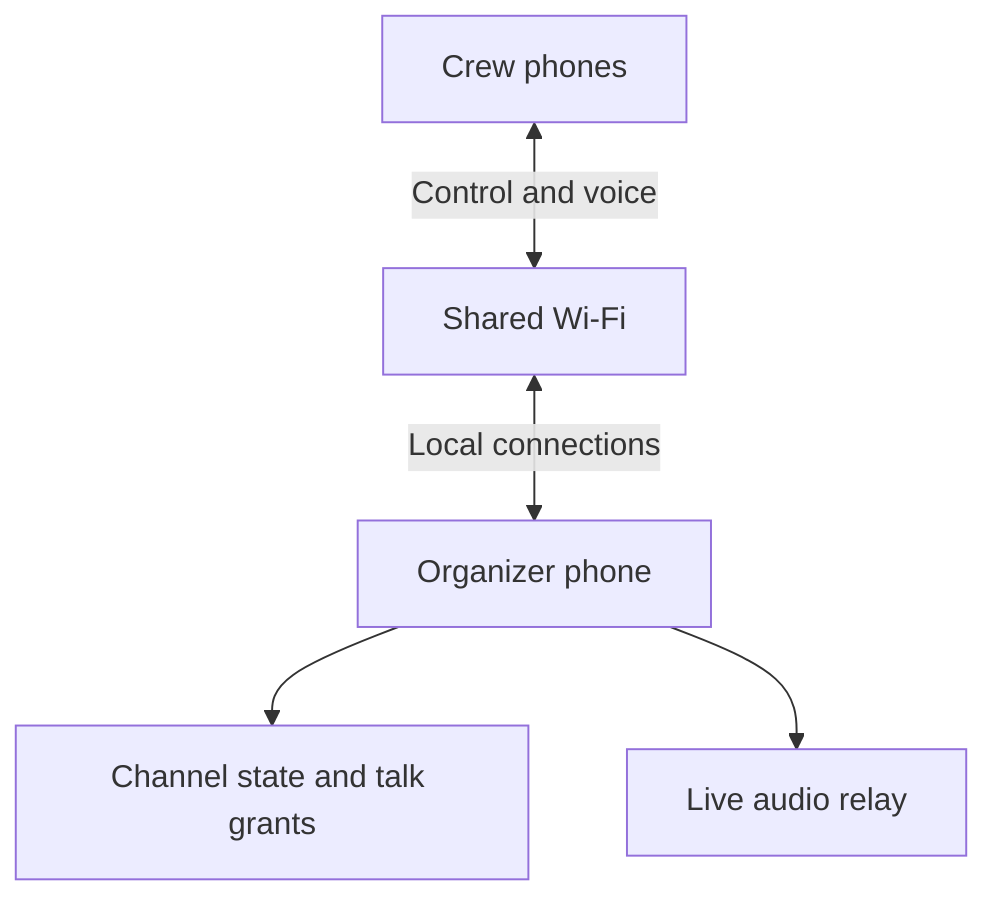

# Walkie Talkie Architecture and Technical Tradeoffs

20 November 2026 · Draft 1 · Android-first, phone-hosted pilot

Architecture decision record for phone-hosted local Wi‑Fi voice. Intended for engineering and venue technical leads.

## System architecture

**Default deployment.** An existing venue Wi‑Fi network or travel router connects the phones. The router needs no custom software. The organizer selects **Create Event**, names the event and gets a QR code. The phone owns the event, channel membership and transmit arbitration. Crew phones have one active channel each, while independent channels can operate in parallel. A phone hotspot is a separate compatibility test because reachability and host behavior may differ from shared router Wi‑Fi.

**Host and client.** Kotlin and Jetpack Compose for both roles in one Android app. Create Event starts an embedded host runtime and exposes hosting status, connected crew count, invite rotation and End Event. The host can talk on a channel using the same authorization and floor state machine as any participant. Keep event settings and memberships in app-private SQLite/Room. Keep presence and talk grants in memory. Start with a plugged-in organizer phone, app visible and hosting screen awake. Prototype an explicitly started Android service for locked hosting, confirm the applicable service type and test actual OS behavior before offering it. Crew duty mode is a separate lifecycle and test matrix. Start it while visible, use an appropriate foreground service where supported, and open the mic only during an authorized transmission. Incoming audio must stop or change routes cleanly on calls, audio focus changes and headset disconnect.

**Local connectivity.** Use a TLS WebSocket for signaling, presence, membership and push-to-talk grants. The QR carries event ID, local endpoint, server identity fingerprint and an expiring admission token. Verify the fingerprint before sending credentials. Allow a manual join using organizer-provided endpoint plus verified identity. Android service discovery can advertise a minimal service and help reconnect after a DHCP address change, but revalidate the pinned identity and event before rejoining. Always support a fresh QR on the new address. Keep discovery metadata free of join credentials. Use the selected Wi‑Fi interface for local connections when cellular is also available. Account for local network permission on Android 17-targeted builds. Client isolation may make a shared SSID unusable. Run a reachability preflight and direct the crew to a compatible network if needed.

**Media implementation.** Spike mono Opus over WebRTC using an Android WebRTC client and an embedded Pion relay packaged as an Android native library. Verify Android build footprint, supported ABIs, LAN ICE, footprint under load and correct sender/receiver lifecycle early. Use the same relay engine in the phone host and optional Linux host if the packaging spike passes. A simple TLS/WebSocket Opus relay is a candidate fallback if native integration blocks the spike, subject to the same latency, burst-loss and recovery gates. Use local ICE candidates with no public STUN or TURN dependency in the pilot topology. At 24 kbps and 19 listeners, one speaker represents about 456 kbps host audio payload egress before overhead. Measure actual uplink airtime, latency, CPU, battery and thermal load with multiple active channels. Prefer forwarding encoded audio to avoid per-listener transcoding.

**Floor protocol.** Client sends a channel-scoped request with a request ID. Host grants one authorized session per channel or returns busy. Grant includes lease and epoch. Only matching active media is forwarded. Play the grant chirp before opening the mic. Release and cancellation close the local mic immediately, then release the lease. An early release must invalidate a late grant. Proposed defaults are a 30-second cap and orphan lease expiry within two seconds. Sequence media per sender and drop stale frames on channel switch, restart or reconnect. The session always resumes in listen mode. Never replay a transmit command after reconnect.

**Host recovery and authority.** Pilot uses one host. On heartbeat loss, show **Host disconnected** and stop hearing or transmitting. If the same device restarts hosting, reuse its persisted identity and event configuration, invalidate active grants and reconnect authorized devices into a new session epoch. Try the last known endpoint and verified local discovery, then offer an updated QR if the network address changed. If the host phone is unavailable, a spare can create a new event and issue a new QR. Rehearse this manual replacement and maintain the agreed crew fallback during the gap. Later planned transfer should use explicit organizer authorization, a new host identity verified by crew clients, a higher epoch and fencing of the old host. Validate network partitions before offering automatic failover.

**Privacy and operations.** Separate organizer controls from crew admission. Store credentials securely on phones, use expiring invites, support immediate revocation, and enforce channel authorization at the host. Encrypt control and media transport. The host is trusted with in-transit audio. Keep voice recording off and retain no voice by default. Local diagnostics can capture grant timings, disconnects and anonymized audio/network statistics under a disclosed retention policy. End Event closes active sessions and invalidates invites. Test concurrent joins, revocation during transmit, process restart and channel isolation.

## Deployment and platform tradeoffs

| Option | Decision | Practical consequence |
|---|---|---|
| Organizer phone and shared Wi‑Fi | Default pilot | Use the same app to create and join. Host needs stable coverage, power and a running session |
| Dedicated wired hub or compatible router running the service | Optional upgrade | Useful for long shifts, permanent buildings and cases where the organizer needs to roam |
| Existing venue Wi‑Fi | Supported after validation | Guest isolation, captive portals, routing policies and roaming can prevent local communication. Verify phone-to-host reachability on the actual event SSID |
| Mobile hotspot | Bench or small backup | Test that attached phones can reach the event host and that the host stays awake |
| Phone-to-phone Wi‑Fi or Bluetooth mesh | Research after the pilot | Multi-peer routing, roaming and background behavior add risk. Bluetooth headsets can still be useful as audio accessories |
| Sound waves | Skip for live event voice | Loud rooms, line of sight and range make it a poor operational fit |
| Internet or APNs path | Optional future mode | Keep it outside the local pilot dependency chain |

**Android lock-screen spike:** Start duty mode while the app is visible. Check screen-off receive over an isolated network after a long idle, across hardware and OS builds, with Battery Saver and interruptions. Evaluate notification Start/Stop and a permitted lock-screen UI for actual press-and-release. OS background launch, notification visibility, device policy and manufacturer restrictions can affect results. Account for the local network permission when targeting Android 17 or above. Define and publish tested devices and behaviors. An app force-stop or powered-off handset is outside active session support.

**iPhone correction and track:** Apple documents offline PTT delivery through Local Push Connectivity. A Network Extension App Push Provider can signal incoming PTT on a configured venue SSID through the local host. Request the app-push-provider entitlement early, verify distribution eligibility for event and building deployments, and test signed builds on locked iPhones with internet disconnected. Use a small wake/control message via the provider and live audio via the app. Address local network permission, system PTT lifecycle and audio routing. Treat background reception and locked reply as acceptance gates. Foreground iPhone operation is a separate milestone if entitlement or behavior blocks offline locked mode.

**Fallback behavior:** If Android misses audio under deep idle on a device, classify it as foreground-only for the pilot. Supply verified organizer-managed devices when locked operation is required. If coverage drops, reconnect to the last authorized channel and show when live audio is restored. If the host fails, use the agreed temporary comms method while the organizer restarts hosting or shares a fresh QR from a spare. Keep this pilot scoped to event operations and building coordination use cases.

## Decision triggers

Keep the organizer phone as the default while rehearsals show acceptable thermals, battery, airtime and recoverability. Consider a wired dedicated host where the venue needs longer service, uninterrupted coverage during organizer movement, or repeatable building operations. Treat peer coordination and automatic handoff as separate research because a partition can create competing hosts. Compare the relay options in the same isolated network using identical latency and loss measurements.

## References

- [Apple · Creating a Push to Talk app](https://developer.apple.com/documentation/pushtotalk/creating-a-push-to-talk-app)
- [Apple · Local Push Connectivity and entitlement](https://developer.apple.com/documentation/networkextension/local-push-connectivity)
- [Android · Foreground service background restrictions](https://developer.android.com/develop/background-work/services/fgs/restrictions-bg-start)
- [Android · Doze and App Standby](https://developer.android.com/training/monitoring-device-state/doze-standby)
- [Android · Network service discovery](https://developer.android.com/develop/connectivity/wifi/use-nsd)
- [Android · Local network permission](https://developer.android.com/privacy-and-security/local-network-permission)
