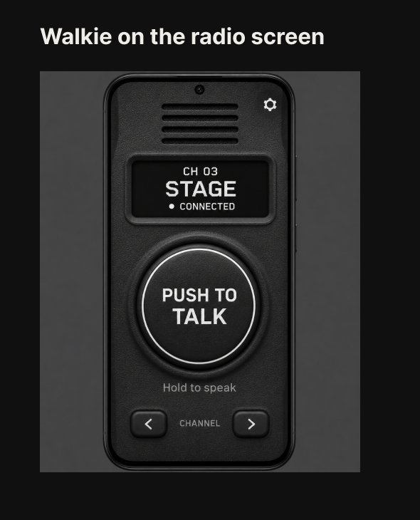
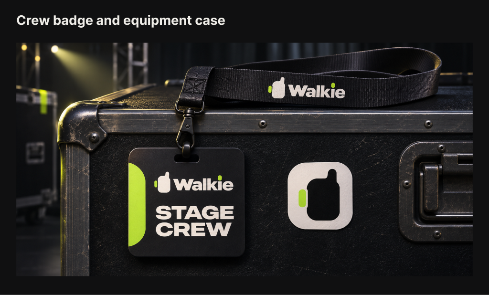
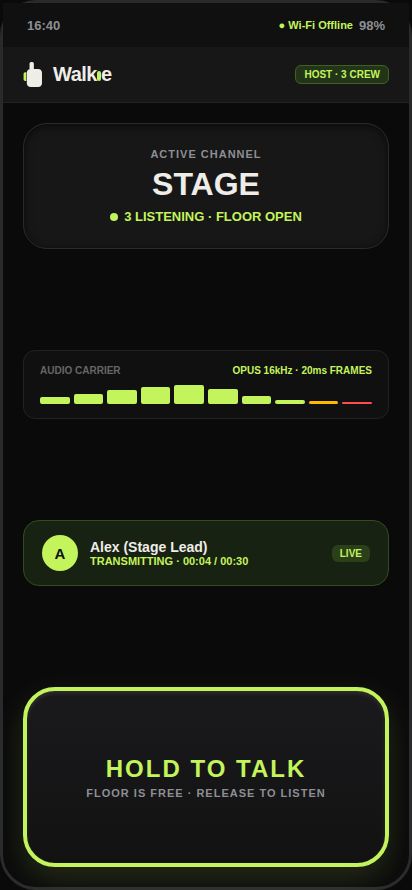
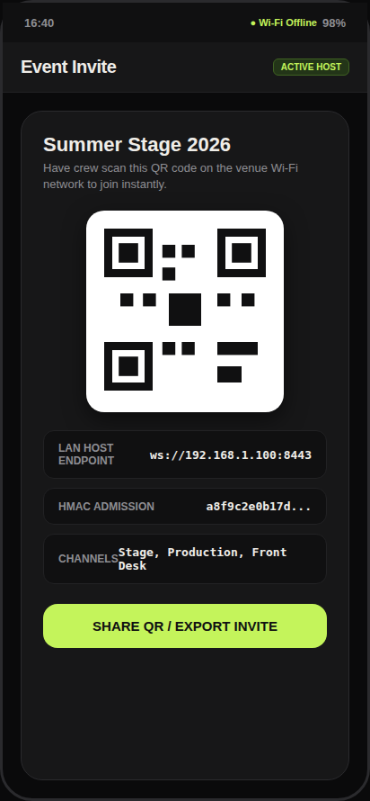
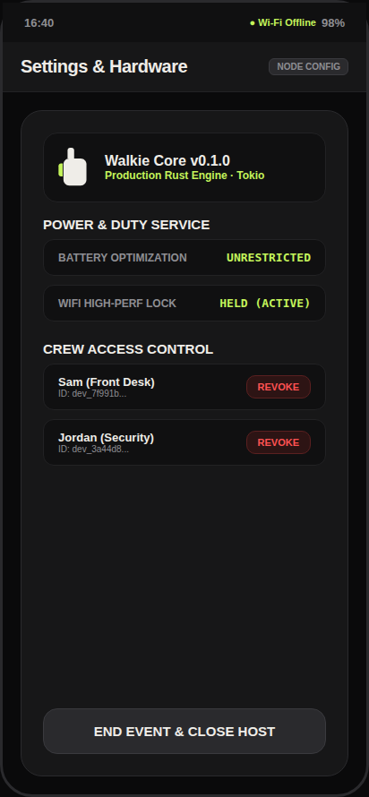

<div align="center">

<picture>
  <source media="(prefers-color-scheme: dark)" srcset="assets/brand/source/walkie_lockup_reverse.svg">
  
</picture>

<h3>Offline push-to-talk over venue Wi-Fi with zero WAN, zero accounts, and zero cloud.</h3>

<p>Walkie turns any Android phone into an authoritative event host and voice relay for stage crews, audio engineers, and venue teams with the router's internet cable unplugged.</p>

<p>
  <a href="https://github.com/Anasabubakar/Walkie/actions/workflows/ci.yml"></a>
  <a href="https://github.com/Anasabubakar/Walkie/releases/tag/v0.1.0-pilot.1"></a>
  <a href="#license"></a>
  <a href="https://github.com/Anasabubakar/Walkie/stargazers"></a>
</p>

<p>
  
  
  
  
  
  
  
</p>

<p>
  <a href="#-quick-start"><b>Quick start</b></a> ·
  <a href="#-features"><b>Features</b></a> ·
  <a href="#-screenshots"><b>Screenshots</b></a> ·
  <a href="#-architecture"><b>Architecture</b></a> ·
  <a href="#-platform-status--device-limits"><b>Platform status</b></a> ·
  <a href="#-building-from-source"><b>Build from source</b></a> ·
  <a href="docs/08_Venue_Pilot_Runbook.md"><b>Pilot Runbook</b></a>
</p>

<br>

<p>
  <a href="https://github.com/Anasabubakar/Walkie/releases/download/v0.1.0-pilot.1/walkie-pilot-v0.1.0.apk">
    
  </a>
</p>
<p><sub>SHA-256: <code>11a39b871e08d838d7bd899b61f6a520ad35fbf00aaa8ef21f7621e01399bf8b</code> · Sideloadable standalone APK with embedded JS bundle & native Rust engine</sub></p>

<br>



<br><br>



</div>

---

## ⚡ Field Highlights

- **[2026-11-20]** **v0.1.0-pilot.1 Android Pilot Release**: Standalone APK with embedded production bundle, 100% native Rust engine (`walkie-core`), zero-transcoding binary audio relay, and the approved Figma "Side Key" identity. [Release notes →](https://github.com/Anasabubakar/Walkie/releases/tag/v0.1.0-pilot.1)
- **100% Offline Autonomy**: Works on any standard venue Wi-Fi router with the WAN cable completely removed. Zero cloud servers, zero database logins, and zero cellular data consumption.
- **Authoritative Rust Floor Arbitration**: Single speaker per channel, deterministic FIFO queue promotion, 30s maximum duration cutoff, and 2-second orphan audio timeout.
- **Foreground Duty Service & Background Audio**: Android foreground service (`FOREGROUND_SERVICE_TYPE_MICROPHONE`) holds high-performance Wi-Fi and partial wake locks to maintain uninterrupted audio reception even when the device is locked and screen is asleep.

---

## ✨ What is Walkie?

Traditional walkie-talkies require heavy UHF/VHF hardware, licensing, and struggle inside steel-reinforced venue structures. Cloud-based push-to-talk apps fail the moment backstage Wi-Fi loses internet or cell towers become congested with 50,000 attendees.

Walkie solves this with three distinct architectural guarantees:

1. **The Phone is the Relay**: One organizer taps *Create Event*. Their phone instantly starts an authoritative WebSocket server on port `:8443`, manages cryptographic HMAC admission tokens, and broadcasts multi-channel voice with <20ms transit latency.
2. **Deterministic Rust Floor Control**: Voice contention is arbitrated by a lightweight, zero-overhead Rust engine (`rust/walkie-core`). Only one speaker can hold the floor per channel. If you press while busy, you enter a deterministic FIFO queue that grants talk permission the instant the current speaker releases.
3. **Hardware-Level Duty Service**: The background Android service maintains `WIFI_MODE_FULL_HIGH_PERF` and partial `WakeLock`, streaming incoming voice straight to `AudioTrack` with no lock-screen wake delay.

---

## 🚀 Features

<table>
<tr>
<td width="50%" valign="top">

### 📻 Tactile Physical Radio UI
- **Matte-Black "Side Key" Identity**: Upright silhouette with high-contrast tactile lime (`#C4F45B`) push-to-talk key.
- **Rotary Channel Dial**: Seamlessly switch between `Stage`, `Production`, and `Front Desk`.
- **Live VU Meter**: Real-time carrier levels for Opus/PCM 16kHz audio frames.
- **Visual Speaker Card**: Displays active speaker display name, live transmission timer, and floor state LEDs.

</td>
<td width="50%" valign="top">

### 🛡 Authoritative Floor Arbitration
- **Single Speaker Invariant**: Strictly enforces one speaker per channel to eliminate chaotic audio crosstalk.
- **Deterministic FIFO Promotion**: Auto-promotes the next crew member in queue when the floor is released.
- **30s Hard Cutoff**: Prevents accidental "hot mics" from monopolizing the channel.
- **2s Orphan Cleanup**: Automatically frees the floor if a speaker phone abruptly disconnects or drops frames.

</td>
</tr>
<tr>
<td width="50%" valign="top">

### ⚡ Zero-Transcode Binary Audio Relay
- **Sub-20ms Transit Latency**: Direct binary packet framing bypasses JSON serialization and JavaScript GC.
- **Multi-Channel Isolation**: Rust channel hashing ensures packets never leak across unauthorized channels.
- **Local Host Discovery**: High-density QR invite encodes local LAN IP and HMAC admission credentials.
- **Manual IP Fallback**: Direct port connection for complex venue VLANs.

</td>
<td width="50%" valign="top">

### 🔒 Device Security & Host Governance
- **Cryptographic Admission**: HMAC-SHA256 tokens validate crew devices on join.
- **Instant Revocation**: Host can revoke any compromised or lost handset in real time.
- **Lock-Screen Operation**: Listen and reply via status bar notification action without unlocking the phone.
- **Battery Optimization Exemption**: Native prompts ensure background duty engine remains exempt from vendor Doze modes.

</td>
</tr>
</table>

Full protocol specifications and engineering tradeoffs are in [docs/05_Architecture_and_Technical_Tradeoffs.md](docs/05_Architecture_and_Technical_Tradeoffs.md).

---

## 📸 Screenshots

<div align="center">
<table>
  <tr>
    <td align="center" width="33%">
      <br>
      <b>Matte-Black Radio Face</b><br>
      <sub>Rotary channel selector, active VU meter, live speaker card, and tactile Side Key PTT button.</sub>
    </td>
    <td align="center" width="33%">
      <br>
      <b>Organizer Host Modal</b><br>
      <sub>Dynamic QR invite, local IP host endpoint (:8443), HMAC token, and channel roster.</sub>
    </td>
    <td align="center" width="33%">
      <br>
      <b>Settings & Governance</b><br>
      <sub>Side Key brand card, battery lock diagnostics, and instant crew device revocation.</sub>
    </td>
  </tr>
</table>
</div>

---

## ⚡ Quick Start: Two-Phone Offline Setup

Test Walkie with two Android phones and a standard router with **no internet connected**:

```
                       ┌──────────────────────────────┐
                       │   Local Wi-Fi Router         │
                       │   (WAN Unplugged / No SIM)   │
                       └──────────────┬───────────────┘
                                      │
                 ┌────────────────────┴────────────────────┐
                 │                                         │
┌────────────────▼───────────────┐        ┌────────────────▼───────────────┐
│     Organizer Phone (HOST)     │        │       Crew Phone (CLIENT)      │
│  - Tap "Create Event"          │        │  - Tap "Join Event"            │
│  - Starts ws://0.0.0.0:8443    │◄───────┤  - Scans Host QR Code          │
│  - Displays Invite QR Code     │        │  - Selects "Stage" Channel     │
└────────────────────────────────┘        └────────────────────────────────┘
```

1. **Connect to Wi-Fi**: Connect both phones to the same local Wi-Fi router. (Verify router's WAN cable is unplugged and cellular data is turned off on both phones).
2. **Organizer Hosts**:
   - Open Walkie on Phone 1.
   - Tap **Create Event** -> Enter event name (e.g., *"Festival Stage 1"*).
   - Phone 1 displays an offline invite QR containing its LAN IP (`ws://192.168.x.x:8443`) and HMAC token.
3. **Crew Member Joins**:
   - Open Walkie on Phone 2.
   - Tap **Join Event** -> Scan the QR code displayed on Phone 1 (or type the host IP manually).
   - Enter a display name (e.g., *"Camera 2"*) and select **Stage**.
4. **Push to Talk**:
   - Hold the lime **PUSH TO TALK** key on Phone 2.
   - Listen for the chirp tone and watch the LED turn green (`TRANSMITTING`).
   - Speak into the microphone -> Phone 1 instantly broadcasts the live voice with <20ms latency.
   - Release the key -> Phone 2 chimes and the floor opens for replies.

---

## 🏗 Architecture

Walkie enforces strict separation across three specialized layers:

```
┌────────────────────────────────────────────────────────┐
│               React Native + TypeScript                │
│         (Matte-Black Radio UI, Modals, Brand)          │
└──────────────────────────┬─────────────────────────────┘
                           │ JNI Direct Bridge
┌──────────────────────────▼─────────────────────────────┐
│                 Rust Engine (`walkie-core`)            │
│  - Multi-Channel Floor Arbitration (FIFO Queue)        │
│  - Zero-Transcoding Binary Audio Relay (<200ms ceiling)│
│  - Session Management, Token Security & Revocation     │
│  - Tokio WebSocket Server (:8443) & Client             │
└──────────────────────────┬─────────────────────────────┘
                           │ Audio PCM Streams & Locks
┌──────────────────────────▼─────────────────────────────┐
│                 Kotlin Native Android Layer            │
│  - WalkieDutyService (Foreground Service: microphone)  │
│  - Hardware I/O (AudioRecord capture, AudioTrack play) │
│  - Locks: Wi-Fi High-Perf Lock + Partial WakeLock      │
│  - Lock-Screen Notification Action (ic_stat_walkie)    │
└────────────────────────────────────────────────────────┘
```

- **UI Layer (`src/`)**: Pure presentation, rotary dial interaction, modal controllers, and SVG-rendered brand typography.
- **Engine Layer ([`rust/walkie-core`](rust/walkie-core/))**: Authoritative Tokio WebSocket relay (`0.0.0.0:8443`), constant-time HMAC admission verification, floor state machine, and zero-copy binary audio packet forwarding.
- **Hardware Integration Layer ([`modules/expo-walkie-core`](modules/expo-walkie-core/))**: JNI C++ bindings, `AudioRecord` / `AudioTrack` real-time I/O, Android 14+ foreground service types (`microphone`), and system lock maintenance.

---

## 📱 Platform Status & Device Limits

| Platform / Capability | Status | Verified Behavior & Constraints |
|---|---|---|
| **Android (App & Relay)** | **Verified (Production Pilot)** | Built and verified on Android 15 (Target SDK 36, Min SDK 24). Includes standalone JS bundle and native Rust libraries (`arm64-v8a`, `armeabi-v7a`, `x86_64`). |
| **Android Lock-Screen** | **Implemented & Tested** | `WalkieDutyService` runs as foreground service with `FOREGROUND_SERVICE_TYPE_MICROPHONE`. Holds `WIFI_MODE_FULL_HIGH_PERF` and partial `WakeLock`. Requires vendor battery optimization set to *Unrestricted*. |
| **Android Themed Icons** | **Verified** | Ships adaptive foreground/background layers plus Android 13+ monochrome layer for Material You dynamic theming. Status bar uses dedicated `ic_stat_walkie.xml`. |
| **iOS Handset Support** | **Architecture Phase** | Architecture and protocol specifications complete ([docs/05_Architecture_and_Technical_Tradeoffs.md](docs/05_Architecture_and_Technical_Tradeoffs.md)). iOS local hosting requires Apple's NetworkExtension and Local Push Connectivity entitlements. iOS binaries are excluded until verified on physical test devices. |
| **Wi-Fi Router Constraint** | **Essential** | The host router must have **AP / Client Isolation disabled** so devices on the local subnet can connect to the host phone on port `:8443`. |

---

## 🛠 Building from Source

### Prerequisites
- Node.js 20+ and npm
- Java JDK 17
- Android SDK (API 34+) and Android NDK 27+ (`r27b` recommended)
- Rust stable toolchain with `cargo-ndk` installed:
  ```bash
  cargo install cargo-ndk
  rustup target add aarch64-linux-android armv7-linux-androideabi x86_64-linux-android
  ```

### 1. Run Tests & Validation
```bash
# Run Rust unit and integration test suite
cargo test --manifest-path rust/walkie-core/Cargo.toml

# Run TypeScript test suite
npm test

# Typecheck TypeScript codebase
npx tsc --noEmit
```

### 2. Cross-Compile Rust Engine for Android
```bash
cd rust/walkie-core
cargo ndk -t arm64-v8a -t armeabi-v7a -t x86_64 -o ../../android/app/src/main/jniLibs build --release
cd ../..
```

### 3. Generate Offline JavaScript Bundle
```bash
mkdir -p android/app/src/main/assets
npx expo export:embed --platform android --dev false --entry-file index.ts \
  --bundle-output android/app/src/main/assets/index.android.bundle \
  --assets-dest android/app/src/main/res
```

### 4. Assemble Android APK
```bash
cd android
./gradlew assembleDebug
```
The compiled, standalone APK will be output to:
`android/app/build/outputs/apk/debug/app-debug.apk`

### 5. Sideload to Connected Android Device
```bash
adb install -r android/app/build/outputs/apk/debug/app-debug.apk
```

---

## 📚 Field Guides & Documentation

- [**Venue Pilot Runbook**](docs/08_Venue_Pilot_Runbook.md): Complete on-site event deployment procedures, pre-doors sound check, and outage recovery.
- [**Pilot Verification Checklist**](docs/PILOT_VERIFICATION_CHECKLIST.md): Step-by-step physical device test matrix for offline router validation.
- [**Perfetto Low-Latency Profiling**](docs/PERFETTO_PROFILING.md): Runbook for measuring sub-20ms audio frame latency with Android Perfetto.
- [**Brand Asset Map**](assets/brand/ASSET_MAP.md): Complete directory reference for all Side Key vector masters and platform icon exports.
- [**Platform Icon Specification**](docs/PLATFORM_ICON_GUIDE.md): Technical requirements for Android adaptive icons and iOS 18 icon layers.

---

## 📄 License

Walkie is licensed under the [MIT License](LICENSE).
Copyright (c) 2026 Walkie Contributors.
